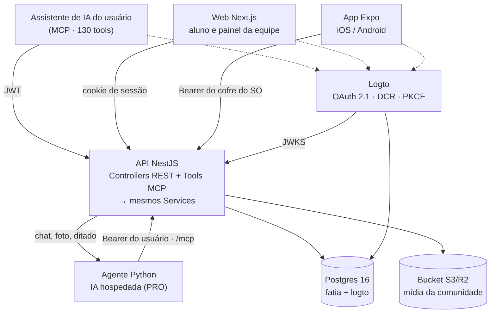

# Fatia

**App de nutrição e treino em português, com a comunidade da sua academia dentro.** Registre a refeição pela foto, pela voz ou numa conversa, com a base de alimentos brasileira; treine com o plano do seu personal; mantenha a constância nos desafios da comunidade. Open source, MCP-first e self-hostable.

[](https://github.com/ThiagoCarreiraVallim/fatia/actions/workflows/ci.yml)
[](https://github.com/ThiagoCarreiraVallim/fatia/actions/workflows/secret-scan.yml)
[](LICENSE)
[](.nvmrc)
[](CONTRIBUTING.md)

## Para quem é

- **Quem treina e quer comer melhor.** App para iOS, Android e web. O plano **FREE** tem o registro inteiro — refeição, treino, água, peso, passos, metas e progresso — sem IA; o **PRO** acrescenta o chat com IA, a foto do prato e o ditado.
- **Academias, boxes e estúdios.** Uma comunidade com a marca da casa: desafios de constância, mural moderado, planos prontos, catálogo dos seus aparelhos com os seus vídeos, um agente com as suas orientações e um painel para a equipe — que complementa o sistema de gestão da academia, não o substitui.
- **Personais, nutricionistas e influencers.** Os mesmos recursos para acompanhar alunos e seguidores, com IA de presente para quem você escolher (assentos pagos pela comunidade).
- **Quem prefere a própria IA ou o próprio servidor.** O conector MCP leva o produto inteiro para o Claude ou outro cliente, sem custo de IA para ninguém; e a stack sobe num VPS com um `docker compose`.

## O que o torna diferente

|                                           |                                                                                                                                                                                                                                   |
| ----------------------------------------- | --------------------------------------------------------------------------------------------------------------------------------------------------------------------------------------------------------------------------------- |
| **Comida brasileira de verdade**          | Os **597 alimentos da TACO** (NEPA/Unicamp) com macros e micronutrientes, medidas caseiras ("1 concha", "1 fatia") e produto embalado pelo código de barras (Open Food Facts). Mais **873 exercícios** com músculos e instruções. |
| **Constância, não comparação de corpo**   | Desafios e rankings medem a aderência de cada um à **própria** meta — dias treinando, dias na faixa de calorias, sequência —, nunca peso ou medida ([ADR 027](docs/ADR/027-desafios-por-aderencia-a-propria-meta.md)).            |
| **O dado é do aluno**                     | A equipe da comunidade só lê o que ele consentiu, por categoria, e cada acesso fica registrado. `export_my_data` devolve tudo e `delete_my_account` apaga tudo. Falta de pagamento tira a IA, nunca o app nem o histórico.        |
| **MCP-first, não "com integração de IA"** | As **130 tools** MCP cobrem o CRUD inteiro. Não existe operação de registro que o app faça e o MCP não faça ([ADR 006](docs/ADR/006-mcp-first.md)).                                                                               |
| **Foto de refeição não vira arquivo**     | A IA analisa a imagem e devolve **dados estruturados**; a foto do prato nunca é guardada ([ADR 004](docs/ADR/004-sem-armazenamento-fotos.md)).                                                                                    |
| **Open source e self-hostable**           | Licença MIT. `infra/docker-compose.prod.yml` sobe API, web, site e Logto atrás do Traefik com SSL automático; `AI_REQUIRES_PLAN=false` libera a IA para a sua instância sem gateway de pagamento.                                 |

O que o produto faz, para quem e o que ele se recusa a fazer: [`docs/PRD.md`](docs/PRD.md).

## Arquitetura em um relance



**Regra de ouro:** tool MCP e endpoint REST que fazem a mesma coisa delegam para o **mesmo método de service**. Lógica de negócio nunca mora no controller nem na tool.

**Por que MCP-first?** [`docs/ADR/006-mcp-first.md`](docs/ADR/006-mcp-first.md). Em resumo: quem já conversa com uma IA no celular tem de conseguir usar o Fatia inteiro por lá. A exceção é a inferência paga pela Fatia — chat, foto e ditado do PRO —, que não sai pelo MCP ([ADR 018](docs/ADR/018-inferencia-hospedada-fora-do-mcp.md)).

> 📸 Capturas de tela do PWA e da conversa via MCP estão pendentes — dependem de uma instância com dados reais. Acompanhe em [#208](https://github.com/ThiagoCarreiraVallim/fatia/issues/208).

## Quick start

Pré-requisitos: Node 24+ (`nvm use`), Docker, e `corepack enable` (para o pnpm 9 pinado em `packageManager`).

```bash
git clone https://github.com/ThiagoCarreiraVallim/fatia.git
cd fatia
pnpm bootstrap   # uma vez: corepack + install + migrate + seed
pnpm dev         # diário: sobe postgres + logto + API + Web com hot reload
```

API em `http://localhost:3000`, Web em `http://localhost:3030`, MCP em `http://localhost:3000/mcp`.

Próximos passos:

- **Rodar e contribuir** → [`docs/ONBOARDING.md`](docs/ONBOARDING.md)
- **Subir o auth (Logto) local** → [`docs/LOCAL_AUTH.md`](docs/LOCAL_AUTH.md)
- **Testar MCP tools com Claude / clientes open-source** → [`docs/MCP_LOCAL.md`](docs/MCP_LOCAL.md)
- **Rodar o app nativo no celular** → [`apps/mobile/README.md`](apps/mobile/README.md)
- **Colocar em produção** → [`infra/dokploy/README.md`](infra/dokploy/README.md)

## Roadmap

O planejamento é público e vive nas **[Issues](https://github.com/ThiagoCarreiraVallim/fatia/issues)**, organizadas em épicas com sub-issues nativas (o painel de progresso de cada épica é gerado pelo próprio GitHub). Nada de checklist em markdown — já tentamos, e apodreceu.

Em andamento:

| Épica                                                            | Assunto                                                                                  |
| ---------------------------------------------------------------- | ---------------------------------------------------------------------------------------- |
| [#275](https://github.com/ThiagoCarreiraVallim/fatia/issues/275) | Pronto para academias, personais e influencers — o que falta antes do piloto (10 épicas) |
| [#38](https://github.com/ThiagoCarreiraVallim/fatia/issues/38)   | Virar conector oficial do Claude — OAuth, hardening, LGPD, submissão                     |
| [#137](https://github.com/ThiagoCarreiraVallim/fatia/issues/137) | Nutrição com IA — foto, código de barras, voz, porção                                    |
| [#146](https://github.com/ThiagoCarreiraVallim/fatia/issues/146) | Engajamento — streaks, conquistas, notificações                                          |
| [#149](https://github.com/ThiagoCarreiraVallim/fatia/issues/149) | Dados e integrações — base internacional e wearables                                     |

O que já foi entregue está nas [épicas fechadas](https://github.com/ThiagoCarreiraVallim/fatia/issues?q=is%3Aissue+is%3Aclosed+Epic) e, as decisões, nas [ADRs](docs/ADR/).

## Contribuindo

PRs são bem-vindas. O guia completo — setup, convenção de commit, fluxo de branch, labels — está em [**`CONTRIBUTING.md`**](CONTRIBUTING.md).

- Procurando por onde começar? [`good first issue`](https://github.com/ThiagoCarreiraVallim/fatia/labels/good%20first%20issue) e [`help wanted`](https://github.com/ThiagoCarreiraVallim/fatia/labels/help%20wanted).
- Dúvida, ideia ou proposta grande? Abra uma [issue](https://github.com/ThiagoCarreiraVallim/fatia/issues/new/choose) **antes** de codar — evita trabalho jogado fora.
- Achou uma vulnerabilidade? **Não abra issue pública.** Siga o [`SECURITY.md`](SECURITY.md).

Duas regras da casa que economizam ida e volta no review:

1. **Isolamento entre contas é 100% da aplicação.** Não há RLS no Postgres ([ADR 010](docs/ADR/010-row-level-security.md)) — todo id que chega por input tem de ser amarrado ao usuário autenticado, e recurso alheio responde `NOT_FOUND`, nunca `403`.
2. **Prove o vermelho.** Teste que protege uma correção precisa falhar sem a correção. Cole a evidência na PR.

## Desenvolvimento assistido por IA

Parte deste repositório é escrita com assistentes de código, e os arquivos que os configuram são versionados de propósito — quem quiser reproduzir o fluxo consegue; quem não usa, ignora.

| Caminho                            | O que é                                                                             | Preciso ler?                                                |
| ---------------------------------- | ----------------------------------------------------------------------------------- | ----------------------------------------------------------- |
| [`docs/CLAUDE.md`](docs/CLAUDE.md) | Regras de código, arquitetura e teste, no formato que assistentes carregam sozinhos | Não. É um recorte do `CONTRIBUTING.md` + ADRs, para máquina |

`.claude/` **não é versionado** — é ferramenta pessoal do mantenedor e não está no repositório.

Contribuição gerada por IA é aceita nas mesmas condições de qualquer outra: você entende o que enviou, os testes provam o vermelho, e a PR passa pelo mesmo review.

## Eval da fronteira de tools

As 130 tools são o CRUD inteiro, e um agente que paga por token talvez pedisse outra fronteira. O
[eval da fronteira](docs/eval-fronteira-de-tools.md) mede isso com uma variável só: o mesmo agente, o
mesmo prompt e as mesmas 31 tarefas contra o catálogo de entidade (**A**, hoje 130 tools) e contra um de
intenção (**B**, hoje 42 tools, das quais 18 compõem as de entidade sem lógica própria), escolhido por um
header no `/mcp`. A medição publicada é de antes das Fases 3 a 5, com 106 e 40. A superfície de intenção é instrumento de medição: só sobe com
`MCP_SUPERFICIE_INTENCAO=1` e é recusada em produção.

Medido em 2026-10-14, 5 repetições por tarefa, com dois modelos pelo OpenRouter
(`z-ai/glm-5.3-flash` e `xiaomi/mimo-v2.6-pro`):

|                            |       glm A |       glm B |      mimo A |      mimo B |
| -------------------------- | ----------: | ----------: | ----------: | ----------: |
| Acerto de seleção, de 31   |          29 |          30 |          27 |          30 |
| Tokens de entrada/execução |      48.204 |      18.236 |      61.321 |      19.743 |
| Custo real por execução    | US$ 0,00261 | US$ 0,00121 | US$ 0,00485 | US$ 0,00290 |

O B acertou mais nos dois modelos e não errou nenhuma tarefa que o A acertou, mas com 1 e 3
discordantes o teste do sinal não separa isso do acaso: **sem diferença detectável** de acerto. O que
muda com folga é o custo, 54 % menor no glm e 40 % no mimo. Nas oito tarefas com uma destrutiva
vizinha da certa, servidas sem a política de confirmação, nenhum modelo a chamou.

Os números valem para o código de `bf03f7f` e para os catálogos medidos. O casamento de nomes do
`record_meal` e da busca de alimentos foi corrigido depois, sem medição nova. Cada medição tem uma
linha no [ledger](apps/agent/eval/fronteira-runs.jsonl), e o doc explica como rodar.

## Documentação

| Arquivo                                                              | Conteúdo                                                                           |
| -------------------------------------------------------------------- | ---------------------------------------------------------------------------------- |
| [`CONTRIBUTING.md`](CONTRIBUTING.md)                                 | Como contribuir: setup, commits, branches, labels, review                          |
| [`SECURITY.md`](SECURITY.md)                                         | Política de segurança e como reportar vulnerabilidade                              |
| [`docs/ONBOARDING.md`](docs/ONBOARDING.md)                           | Setup local, scripts, modos de desenvolvimento, troubleshooting                    |
| [`docs/LOCAL_AUTH.md`](docs/LOCAL_AUTH.md)                           | Logto local: tenant, apps, API resource, `.env`                                    |
| [`docs/MCP_LOCAL.md`](docs/MCP_LOCAL.md)                             | Registrar o MCP local no Claude Desktop / Code / clientes open-source + smoke test |
| [`docs/PRD.md`](docs/PRD.md)                                         | Product Requirements — o que é o produto, escopo, não-escopo                       |
| [`docs/ARCHITECTURE.md`](docs/ARCHITECTURE.md)                       | Arquitetura técnica, stack, decisões                                               |
| [`docs/DESIGN.md`](docs/DESIGN.md)                                   | UX, telas do PWA, fluxos                                                           |
| [`apps/mobile/README.md`](apps/mobile/README.md)                     | Rodar o app nativo localmente, configuração, troubleshooting                       |
| [`apps/agent/README.md`](apps/agent/README.md)                       | Agente de IA em Python: rodar, lint, teste, configuração de provedor               |
| [`docs/MOBILE_PARITY.md`](docs/MOBILE_PARITY.md)                     | Paridade entre o app nativo e o PWA, rota a rota e componente a componente         |
| [`docs/MCP.md`](docs/MCP.md)                                         | Especificação das tools MCP expostas                                               |
| [`docs/eval-fronteira-de-tools.md`](docs/eval-fronteira-de-tools.md) | Eval da fronteira de tools: entidade × intenção, método e resultados               |
| [`docs/THREAT_MODEL.md`](docs/THREAT_MODEL.md)                       | Modelo de ameaças e decisões de isolamento                                         |
| [`docs/OPERATIONS.md`](docs/OPERATIONS.md)                           | Runbook de produção, backup e recuperação de desastre                              |
| [`docs/BILLING.md`](docs/BILLING.md)                                 | Plano PRO, assentos de comunidade, webhooks e roteiro de sandbox                   |
| [`docs/PERMISSIONS.md`](docs/PERMISSIONS.md)                         | Papéis da comunidade e o que cada um pode fazer                                    |
| [`docs/DATA_RETENTION.md`](docs/DATA_RETENTION.md)                   | O que é guardado, por quanto tempo, e como sai no export e na exclusão             |
| [`docs/TESTAR_O_APP.md`](docs/TESTAR_O_APP.md)                       | Testar o app no celular, do cadastro ao roteiro                                    |
| [`docs/ADR/`](docs/ADR/)                                             | Architecture Decision Records                                                      |

## Estrutura

```
fatia/
├── apps/
│   ├── api/           # NestJS (REST + MCP)
│   ├── web/           # Next.js PWA
│   ├── mobile/        # React Native (Expo) — réplica nativa do PWA
│   ├── site/          # Astro — landing e documentação pública
│   └── agent/         # Python — agente de IA (ADR 015), fora do workspace pnpm
├── packages/
│   ├── api-client/    # cliente de API compartilhado entre web e mobile
│   └── db/            # Prisma schema + client compartilhado
├── infra/             # docker-compose, Dockerfiles, backup
├── scripts/           # setup, dev, smoke test do MCP, varredura de segredo
└── docs/              # Documentação
```

`packages/api-client` existe para que o PWA e o app nativo falem com a API pelo **mesmo** código. O que muda entre eles é só o transporte: o web passa pelo proxy do Next (o token fica no servidor), o mobile chama direto com o Bearer do cofre do sistema.

## Stack

- **Backend:** NestJS 11, Prisma 6, Postgres 16, JWT validado via JWKS
- **Frontend:** Next.js 15, React 19, Tailwind, shadcn/ui, Recharts
- **Mobile:** Expo SDK 57, Expo Router, NativeWind, react-native-svg
- **Site:** Astro
- **Agente de IA:** Python (FastAPI + LangGraph + `uv`), cliente OpenAI-compatível — LM Studio em dev, OpenRouter em produção (modelos revisados em `allowed_models.py`), traces no Langfuse com máscara
- **Pagamentos:** Asaas na web (Pix, boleto, cartão) e RevenueCat nas lojas
- **Mídia e avisos:** bucket S3 (R2 em produção), push pela Expo e Web Push
- **Infra:** Docker Compose atrás do Traefik (Dokploy), no servidor próprio
- **MCP:** `@modelcontextprotocol/sdk` exposto via HTTP no NestJS

## Licença

[MIT](LICENSE). Use, modifique, hospede, cobre por isso — só mantenha o aviso de copyright.
